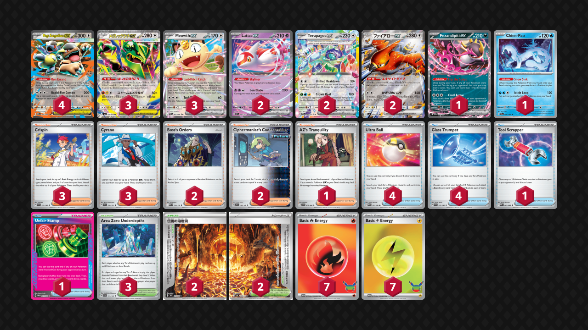
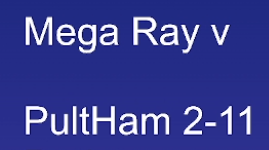

## Decklist


```decklist
Pokémon: 18
4 Mega Kangaskhan ex MEG 104
3 Mega Rayquaza ex M6 58
3 Meowth ex POR 62
2 Latias ex SSP 76
2 Terapagos ex PRE 92
2 Talonflame ex M6 62
1 Fezandipiti ex ASC 142
1 Chien-Pao SSP 56

Trainer: 28
3 Crispin SCR 133
3 Cyrano SSP 170
2 Boss's Orders MEG 114
2 Ciphermaniac's Codebreaking TEF 145
1 AZ's Tranquility CRI 76
4 Ultra Ball MEG 131
4 Glass Trumpet SCR 135
1 Tool Scrapper WHT 85
1 Unfair Stamp TWM 165
3 Area Zero Underdepths SCR 131
2 Legendary Lava Cave M6 75
2 Legendary Lava Cave M6 76

Energy: 14
7 Fire Energy MEE 10
7 Lightning Energy MEE 12
```
### Inclusions

- Need to start with Mega Kangaskhan for draw and activating Talonflame. Four is mandatory.
- Triple Rayquaza and triple Meowth are necessary. Often end up using all three of them in a game. Fourth Meowth could even be considered.
- Tera package is the only viable way to play Rayquaza that I know of. It solves many problems, such as getting 3-3’d or not having enough Energy in play for a big KO, both of which are particularly important against Dragapult. Terapagos is a solid two-prize attacker. Area Zero makes bench space, which otherwise gets too clogged, and more importantly, lets you remove liabilities from play.
- Chien-Pao removes damage or three-prize Pokemon from play. It’s not practical to rely on Pyroduct for doing this. Chien-Pao is very important for removing lose conditions and keeping control of the game.
- Crispin and Glass Trumpet are the best Energy acceleration options. Glass Trumpet helps against Hammer and makes Ultra Ball’s discard painless or beneficial. It’s also a very efficient and powerful form of Energy acceleration. Otherwise, it’s too difficult to flood the board with Energy for Rayquaza and actually get it powered up. Four Trumpets are mandatory.
- Cyrano is required to play the game. Often want to play one or even two early.
- Ciphermaniac’s Codebreaking is incredibly valuable for making combos. It also allows Talonflame to basically get three cards for the price of two, and also play around Eri. More importantly, it allows access to Stamp even if you did not just use Talonflame, or if your hand was disrupted.
- Boss’s Orders is pretty self-explanatory. The deck doesn’t need more than two though.
- AZ’s Tranquility is a pretty bad card but it’s probably the best switching option. I want a switch option to give an out to retreat lock, improving the Slop matchup. One switching option is enough, as you can use Chien-Pao to prevent yourself from getting re-locked if necessary. Usually you win on tempo after just one switch though.
- Tool Scrapper is primarily for swinging the matchup against Alakazam, as it counters their Genesect. It can also be used against random Capes and Mochis, though it doesn’t impact those matchups all that much overall.
- Unfair Stamp is your win condition in several matchups and goes well with Talonflame. Considering a different Ace Spec would be atrocious, and would at minimum require a rework of the deck.
- Area Zero is very strong and ends up being used in most matchups. It’s a win condition against Dragapult along with Chien-Pao, enables Terapagos as a strong two-prize attacker (against two-prize decks mostly), and the board manipulation ends up being relevant very often in general. I think it’s worth playing three copies. I’m not sure if you can get away with two, but it might be possible.
- Pyroduct is the win condition primarily against Alakazam, Crustle, and Festival Lead, which would otherwise be losing matchups. It is occasionally useful in other matchups such as Dragapult, Zoroark, and Hydrapple. Along with Unfair Stamp, it gives you a reasonable comeback option against those decks, and can also randomly body them.

### Possible Inclusions

- Lillie’s Determination is a very good card and would be useful in this deck. For awhile, I played two copies, but ended up cutting them for space reasons even though they’re still good.
- One or two (or possibly more) copies of Adventure Lantern would be pretty good, especially as the occasional option off Talonflame. It’s just an issue of space. I don’t want to trim down the count of Energy because hitting Energy off Rayquaza’s Ability is very important.
- If the Rayquaza mirror becomes very popular, a tech Tapu Koko ex could be decent.
- Switch or Pecharunt ex could be considered over the AZ. I tried both and can’t say for sure which switching option is best. AZ’s healing 80 can be relevant though.
- Ursaluna could maybe be ok since it’s a good card, but I haven’t given it much thought in this deck.

### Exclusions

- The Ho-Oh version of the deck is just bad and non-functional. It can’t beat Pult and is far inferior in every aspect.
- Judge doesn’t actually do anything. It seems like it would be good in theory, but in practice does nothing (and you’d always rather play a different Supporter). The one thing it does do is give you another roll at disrupting against Alakazam but that is not a good enough reason to play it, and you can’t cut Scrapper or anything else for it.
- Special Red Card might seem good but it’s harder to use than you’d think because you always want to start off attacking with Talonflame and minimize the chances of your three-prizers getting KO’d. In any case, Stamp is sufficient and better.


This is what happens when you play the Ho-Oh build.

## Gameplay Tips

- I honestly have no idea if it’s better to go first or second. Going first can be good because of Run Errand (if you start Kang), potentially attaching to Talonflame, and the fact that your opponent can’t really punish you even if you do nothing. However, the manual attachment isn’t all that important aside from Talonflame, which is hard to get on Turn 1 going first. On the flip side, sometimes going first you literally can’t do anything and it feels bad but I don’t know if it actually matters. Furthermore, about 20-25% of the time you get Turn 1 Talonflame going second and you’re instantly way ahead. For this deck and opposing decks, you usually need a Supporter to get going anyway. Going first is more important against decks that can evolve to get going, such as Dragapult, Alakazam, and Festival Lead. For now, I would go first against those decks as well as blind, and second against everything else, but I don’t know if that’s correct.
- Using Talonflame to attack to start the game is almost always best. Even in scenarios where Talonflame doesn’t seem like it would be that great or efficient, it’s still probably the best thing to do. There are rare exceptions but for the most part it’s just go Talonflame.
- Ultra Balling away Energy in the early-game is often good, even if you have useless cards in your hand to discard instead. Getting Energy in the discard is usually better than getting rid of useless cards, but it’s very situational. Of course, if you already have enough Energy in there, or don’t otherwise have manual attachments lined up, you should keep the Energy.
- If you have a way to shuffle your deck that you don’t mind using, you can use Rayquaza’s Ability to scout your draws and slightly optimize them (effectively “thinning” four cards). If those cards were ones you want to draw into, shuffle your deck before drawing. It’s the same logic as with Metang’s Metal Maker.
- Against decks with Stamp, it’s not out of the question to keep double Kang on board just to be more resilient to Stamp. If you do that, you may have to eventually use Chien-Pao to protect yourself from getting 3-3’d.

## Matchups

### Dragapult - Favorable

Against Hammers, Blaziken, and Dusknoir, the matchup is favorable. Against Dudunsparce ex, it’s about even or slightly unfavorable.

- Try to get Talonflame going as soon as possible. Use it early and to recover off hand disruption if needed. Your early-game searches off Talonflame should prioritize getting Energy in play. Search out cards such as Crispin, Glass Trumpet, Area Zero, and Rayquaza. Boss can occasionally be good too. If you have to Talonflame attack into a Dragapult one time to recover off disruption, that’s fine.
- Discarding Energy off Ultra Ball is a little less important against Hammer build since Crushing Hammer will naturally cause Energy to end up in the discard.
- Chien-Pao enables comebacks. It clears damage off the board and denies them a 3-3 line. Try to always keep a Chien-Pao play open, and you may need Trumpet to reload Energy onto the board if Chien-Pao discards too much Energy.
- Pyroduct is not part of the main game plan, but sometimes it randomly does win games. Don’t prioritize it, especially compared to Area Zero, but keep an eye out for situations where it could be good. If you happen to have it in hand with nothing better to do, and the opponent has low hand size or Stadiums left, it’s usually fine to just slam it. That said, it’s not an important resource so it can be used as Ultra Ball fodder.
- Against the build with Dudunsparce ex, try to play with a board of only four Pokemon in play in the early-game. It’s fine to delay Rayquaza ex or even Terapagos if necessary, as we must not feed them easy Dudunsparce KO’s. If they don’t have Dunsparce down and you’re able to start attacking quickly, this can be an exception where you full commit to tempo and don’t care about Dudunsparce ex.

```youtube
id: NQEUWtQn6UI
title: Ray v PultDudun 1
```

```youtube
id: ez-5HY2yzgc
title: Ray v PultBlaze 1
```

Unfortunately I didn’t get many good or interesting games against Dragapult. The only close ones were games where Pult won. When Ray won, it was mostly just steamrolls. If you want to see those to see how Ray wins, they should be available on the twitch vod for a limited time.

### Raging Bolt - Even

This matchup is better against the Cape build, and worse against Stamp. Either way, it’s still close to even, but could be slightly one way or the other depending on the opponent’s list.

- Even though Talonflame doesn’t one-shot anything, it’s still best to start attacking with it early. I frequently grab Boss (to finish off whatever I smacked if I don’t get KO’d) along with Stamp (in case I do get KO’d). Other than those cards, prioritize getting Energy into play or in the discard.
- Play around Clefairy. Keeping four Pokemon on the bench instead of five is pretty important because it means their Clefairy caps out at 260 even with Area Zero. This is less important in the early-game or when their board is not very developed, as they won’t be able to go full board at that point anyway. It’s very important to keep in mind in the mid- and late-game and is often the difference between winning and losing.
- Deny them a 3-3 line. Attacking with Talonflame early and then Terapagos can be good since they are two-prizers. For example, if they Boss-KO a three-prize Pokemon, try to respond KO with Terapagos so they can’t easily win by KO’ing a Ray. Once they take a two-prize KO, it’s better to use Ray since it’s harder to KO than Terapagos.
- Watch out for hand disruption. If you’re KO’ing Kang as your first KO (not ideal, but usually what ends up happening), they can use Special Red Card right away. Make sure you have sufficient board protection (some combination of Kang, Fez, lots of Energy on Ray) so that you aren’t stuck after getting Red Carded. The same applies if they’re attacking with Talonflame and play Stamp. Don’t take the KO until you’re ready to get Stamped. In Talonflame wars, if you don’t have sufficient board presence, he who gets Stamped first loses.
- Ciphermaniac can play around Special Red Card if you’re KO’ing their Kang with something besides Talonflame (usually you’re using Talonflame to two-shot it though).
- Stamp plus Boss KO their draw is the most reliable way to make a comeback, and it’s an extremely strong play in general. Sometimes it’s better to KO their Raging Bolt and then do that play on the following turn, since Raging Bolt is a present threat. But it depends on the situation, such as if they have extra Energy in play. If you Stamp + KO Kang / Fez and leave Raging Bolt, it’s probably not going to be a problem if they don’t have any Energy in play anyway.
- Keep AZ (or other switching card) around so that you can escape from Sob. Usually the tempo from AZ is enough to put you ahead so you don’t need to worry about getting Sobbed again, but some exceptions exist. If you’re worried about it, Chien-Pao can remove Latias from play (and everything else can attack while stuck).

```youtube
id: KEuPsjIcyKk
title: Ray v Bolt 1
```

```youtube
id: TDOvqaLb17w
title: Ray v Bolt 2
```

```youtube
id: H94KNR-YL-0
title: Ray v Bolt 3
```

```youtube
id: YQtvh6S7Rrg
title: Ray v Bolt 4
```

### Zoroark - Unfavorable

The more Stadiums they play, the worse this matchup gets. The hardest one is the heavy Watchtower build. Even against the normal version with just two N’s Castle and no Watchtower, the matchup is still unfavorable or slightly unfavorable.

- Using Talonflame to swing into Zoroark is not ideal since it gives them lots of Munkidori damage, but it may be necessary in some situations. Attacking with Talonflame in the early-game is still very good in general, especially if you can KO single-prize Pokemon. If you manage to KO two single-prizers before they get going, you will probably win.
- If you’re behind in the trade, you’ll have to rely on Stamp Pyroduct. This is the main game plan since it’s hard to be in a winning trade.
- If you do manage to get the first two prize cards and then they open with Boss-KO on Ray, respond with Boss-KO on Pecharunt with Terapagos to maintain the winning trade.
- You don’t have to take a KO when you use Stamp Pyroduct, especially if they have Fez down. If you’re playing to brick them, you’ll have to KO their Fez before KO’ing anything else. Kang is a somewhat reliable wall to buy a turn if necessary (but it’s situational).
- Targeting down Zekrom with Talonflame Boss can be a way to win by making them whiff Zekrom, but it’s more of a desperation option since this deck only plays two Boss and you’re basically wasting them if they do happen to recover Zekrom twice.

```youtube
id: aBB8KegXeT8
title: Ray v Zoro 1
```

```youtube
id: iMSNMv_kMAc
title: Ray v Zoro 2
```

### Alakazam - Even

Against the normal build of Alakazam with four Stadiums, the matchup is about even. The fewer Stadiums they play, the better the matchup gets. Against Alakazam / Dusknoir, it’s very favorable.

- Don’t put down Rayquaza early because it can get punished. You only need Rayquaza for KO’ing their Fez if they preemptively put it down (which they should), so you don’t necessarily need it right away. If you put Ray down too soon, they can hold off on Fez and do nothing, forcing you to go into Special Red Card range and then 3-3 you off that.
- The gameplan is to use Talonflame to gather Pyroduct, and then use Ciphermaniac for Scrapper (on Genesect) + Stamp and hit them with the combo all at once.
- Play around Eri by not taking Stamp or Scrapper off Talonflame, leave them in the deck and then get them off Cipher. You’ll need a way to get Fez in hand (or Fez on the board) and possibly even a second Kang in case they KO your Kang. All of this isn’t necessary if they don’t play Eri, as you can directly grab the Items in that case.
- If you do rely on Cipher on the combo turn, you can’t Boss-KO their Fez on the same turn, so just pass instead of taking a KO, and then KO their Fez with Ray on the next turn. Of course, if they don’t have Fez in play, it’s fine to indiscriminately take KO’s.
- If they are going for the passive route and waiting for you to activate Special Red Card, make sure you don’t have two three-prize Pokemon on your board. You’ll want double Talonflame and Fez in play to recover off Red Card. If necessary, use Chien-Pao to fix your board and make sure they can’t 3-3 you.

```youtube
id: N-9MpBsRkjo
title: Ray v Zam 1
```

```youtube
id: S2RcFuATnTk
title: Ray v Zam 2
```

### Slowking - Favorable

- Similar to other matchups, the plan is to either win a prize trade outright or use Stamp + KO their draw to make a comeback if you’re behind.
- If they don’t feed you a two- or three-prize KO, you’ll need both Boss’s Orders to win the trade. Most of the time, you’re going for a 3-2-1. If you manage to KO an active Kang or two-prizer, you may only need one Boss’s Orders. For the 1, you can simply KO their active Slowking whenever it’s most convenient (or when you don’t have Boss), which is totally fine.
- When using Stamp to make a comeback, KO either their Fez or Kang on their Stamp turn. They can recover Fez with just a Stretcher, but it’s harder for them to use Run Errand if you KO their Kang. Usually I’ll just KO the Fez, unless they’re playing triple Stretcher and have all of them left.
- Stadiums are a useful resource to constantly bump their Academy at Night.

```youtube
id: uTAyKTOHJ50
title: Ray v Slowking 1
```

### Excadrill - Very Favorable

- Prioritize piling as much Energy into play as possible so that Rayquaza can one-shot their Excadrill. Early Talonflame is great as usual, especially because it can get a KO or two.
- Scrapper and Pyroduct can be useful, but they’re not a priority since you can still win without them.

### Crustle - Very Favorable

- It’s important to understand their win condition, which is getting triple Crustle and bumping Pyroduct whenever you play it. Therefore, we should play to deny them triple Crustle. If you can ever KO a Dwebble before it evolves, that’s basically instant win.
- Prioritize Boss KO on Dwebble. If they have something like Crustle or Kang active with a Dwebble on the bench, don’t take the KO because it gives them free Ascension. Just let it sit there and try to get Boss before they can evolve it.
- You can’t sit around for too long because Xerosic can body you, so you do want to go in with Pyroduct fairly quickly. Use Pyroduct on the turn you can KO their Crustle. Try to play around Eri and Xerosic to the best of your ability.

### Hydrapple - Even

- Once again, this is a matchup where you either prize trade or come back with Stamp. In this case, Stamp + Pyroduct is a particularly strong comeback condition because it shuts off their Meganium
- If they have Fez in play, KO that on your Stamp turn, ideally with Pyroduct as well.
- If you’re winning the trade normally, you don’t really need Pyroduct as much. It’s not a priority, but it can still be useful.
- The main lose condition in this matchup is their Stamp, and there’s not a whole lot you can do about it. They can feed a single-prizer such as Celebi to Talonflame, and if they happen to have Stamp, it can be troublesome. You could sit around and wait for them to activate Stamp first, but I think this too sketchy because they can set up a more resilient board and win the trade. Therefore, I think it’s better to build as robust a board as you can so that you’re more resilient to Stamp (Kang, Fez, lots of Energy) and just try to win the trade.
- Can use Terapagos as an attacker if you’re in danger of getting 3-3’d.

```youtube
id: 1087wX8dOXw
title: Ray v Hydrap 1
```

```youtube
id: ThUdlx124MM
title: Ray v Hydrap 2
```

### Festival Lead - Favorable

- Set up for Stamp Pyroduct and make them brick off that combo. It’s even more effective if you can combo it with Boss and Fez Cruel Arrow, but that’s not always necessary or possible.

```youtube
id: ZOFC69WIz8o
title: Ray v Festival 1
```

### Hide n Sneak - Favorable

- Against the Spiritomb build, make sure to play around them taking six prizes on one turn with it. This can be done by limiting your three-prize Pokemon in play (Rayquaza is only needed if they put a two-prize Pokemon down) or clearing them off with Chien-Pao later.
- Against Dudunsparce, Stamp + Pyroduct can make them brick. Even against non-Dudunsparce, Pyroduct can still be useful to clear off damage by bumping Area Zero. In case of Dudunsparce ex, try to keep your board to four Pokemon total at the beginning of the game. If you have to expand it later to clear off damage, that’s fine.
- In general, Chien-Pao and Pyroduct are important resources to clear off damage, which is your main strategy regardless of whether they use Dhelmise or Sinischa.

### Bronzong - Favorable

- Pile Energy into play as quickly as possible so that Rayquaza can one-shot Lopunny.
- Pyroduct can stop Dusknoir. Sometimes it’s very strong because it’s hard for them to find Stadiums, but sometimes it’s not necessary. I wouldn’t prioritize it unless you’re lacking better options.

## Personal Thoughts

This deck is actually pretty good and its matchup spread is insane. However, other (non-Tera) builds are bad and lose to Pult.
