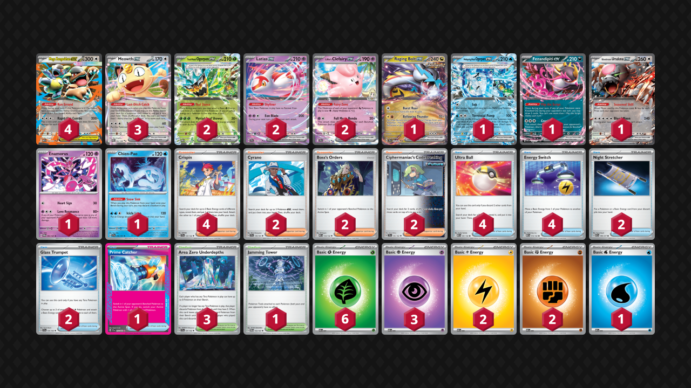
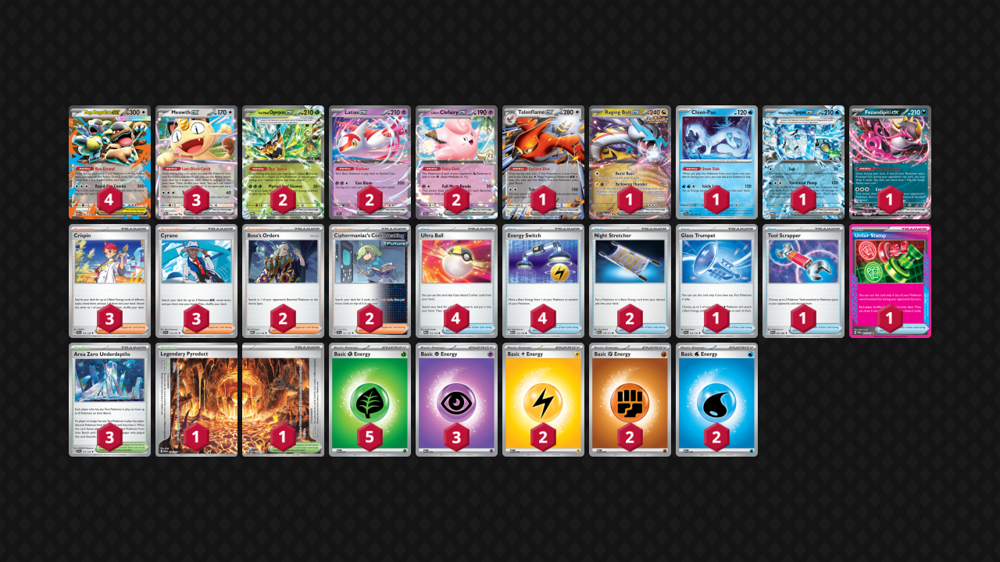
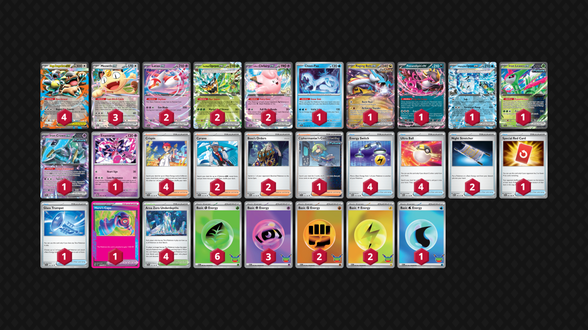

<!-- PUBLIC -->
## Decklist 1


```decklist
Pokémon: 19
4 Mega Kangaskhan ex MEG 104
3 Meowth ex POR 62
2 Teal Mask Ogerpon ex TWM 25
2 Latias ex SSP 76
2 Lillie's Clefairy ex JTG 56
1 Raging Bolt ex TEF 123
1 Wellspring Mask Ogerpon ex TWM 64
1 Fezandipiti ex ASC 142
1 Bloodmoon Ursaluna ex TWM 141
1 Enamorus TWM 93
1 Chien-Pao SSP 56

Trainer: 27
4 Crispin SCR 133
2 Cyrano SSP 170
2 Boss's Orders MEG 114
2 Ciphermaniac's Codebreaking TEF 145
4 Ultra Ball MEG 131
4 Energy Switch MEG 115
2 Night Stretcher ASC 196
2 Glass Trumpet SCR 135
1 Prime Catcher TEF 157
3 Area Zero Underdepths SCR 131
1 Jamming Tower TWM 153

Energy: 14
6 Grass Energy MEE 1
3 Psychic Energy MEE 5
2 Lightning Energy MEE 4
2 Fighting Energy MEE 6
1 Water Energy MEE 3
```

### Inclusions

- Each Mega Kangaskhan is roughly an additional ten percent chance to start with it. This is particularly important because the deck highly relies on Run Errand to draw cards and function, so playing four makes sense.
- Double Latias has become standard because it's crucial for the deck to function and find early.
- Bloodmoon Ursaluna is a very efficient closer and takes the spot of the second Fez. Although two Fez it's great, it's not as necessary when Ursaluna can close out games in a low-maintenance way.
- Wellspring Ogerpon provides good utility. It can be a fast attacker or buy time with Sob in the late-game to piece together a win.
- Chien-Pao is fantastic against Dragapult for clearing off damage or countering Watchtower. Four Stadiums are similarly included to easily deal with Watchtower since the deck highly relies on Kang and Meowth. Area Zero is also important for buffing Clefairy's damage or synergy with Chien-Pao.
- Enamorus is a solid single-prize attacker that primarily counters Crustle. It can also one-shot Dragapult, though it would need Clefairy and sometimes Raging Bolt to do so. Worth noting that you need either Jamming Tower or Hero's Cape along with Enamorus to reliably beat Crustle.
- Jamming Tower is mostly for Cape decks, such as Crustle and Excadrill. Bumping your own Pokemon is also very good if Chien-Pao is not available.
- Second Glass Trumpet over third Teal Mask Ogerpon is what I'm currently liking, but I could change my mind about that. It's also a bit better with Ursaluna.
- Ciphermaniac is very handy for making combos, but not overly relied on.
- Prime Catcher is a powerful card for both the gust and switching options. It allows Crispin plus gust in the same turn, and is also the only way out of retreat lock. I think this deck greatly benefits from a third gust effect, so if you play a different Ace Spec like Stamp, I would recommend a third Boss's Orders as well.

### Possible Inclusions

- Passimian is a little better now with more Dudunsparce and Kang in the metagame.
- Talonflame ex is good, especially if you also play Unfair Stamp along with it.
- Iron Crown plus Special Red Card is quite strong against Festival Lead. This combo also helps against Alakazam, though that matchup is still pretty bad.
- Mew ex is probably fine but I don't think it's as good as all the hype. With four Energy Switch, Mew's versatility isn't necessarily required for this deck.
- Unfair Stamp is still very good. I just don't think it synergizes very well with the deck. The same can be said for Special Red Card. Alone, those cards aren't enough to salvage bad matchups, but they're still generally good cards.
- Hero's Cape is good against Dragapult decks that don't have Jamming Tower. It's a neutrally strong card, but sometimes ineffective against decks that can easily target the bench since this deck will always have liabilities in play. Therefore, some decks can just ignore the Cape entirely.
- Lillie's Determination is still good.
- An additional Fez, Ogerpon, Area Zero, Cyrano, or Grass Energy would all be fine.

### Exclusions

- The second Raging Bolt isn't very important.
- Iron Leaves is bad and useless. Retreat lock is no problem since every Pokemon (besides Chien Pao) can attack, and we also have Prime Catcher.
- I think Paldean Tauros is bad and worse than Enamorus. The only real reason to play it over Enamorus is the Excadrill matchup, which I just don't care enough about.

## Decklist 2


```decklist
Pokémon: 18
4 Mega Kangaskhan ex MEG 104
3 Meowth ex POR 62
2 Teal Mask Ogerpon ex TWM 25
2 Latias ex SSP 76
2 Lillie's Clefairy ex JTG 56
1 Talonflame ex DLR 88
1 Raging Bolt ex TEF 123
1 Chien-Pao SSP 56
1 Wellspring Mask Ogerpon ex TWM 64
1 Fezandipiti ex ASC 142

Trainer: 28
3 Crispin SCR 133
3 Cyrano SSP 170
2 Boss's Orders MEG 114
2 Ciphermaniac's Codebreaking TEF 145
4 Ultra Ball MEG 131
4 Energy Switch MEG 115
2 Night Stretcher ASC 196
1 Glass Trumpet SCR 135
1 Tool Scrapper WHT 85
1 Unfair Stamp TWM 165
3 Area Zero Underdepths SCR 131
1 Legendary Pyroduct DLR 94
1 Legendary Pyroduct DLR 95

Energy: 14
5 Grass Energy MEE 1
3 Psychic Energy MEE 5
2 Lightning Energy MEE 4
2 Fighting Energy MEE 6
2 Water Energy MEE 3
```

### Inclusions

- This list makes use of the Pyroduct disruption package to cover various matchups that would otherwise be bad: Alakazam, Festival Lead, Crustle, and Hydrapple. I realized that the same idea as with Rayquaza could be ported over to this deck, as they both have access to Talonflame. The main downside is that it's just a lot of pieces to not prize, since the deck doesn't really have too much extra space to commit to this combo.
- Double Ciphermaniac helps play around Eri, for example against Alakazam and Crustle. It ensures that you can always get the combo off.
- Tool Scrapper counters the Genesect in Alakazam so you can still combo off on them.
- The second Water Energy allows for more consistent Waterpon access, as well as threatening Chien-Pao to attack against Crustle. This forces Crustle to activate Unfair Stamp and make themselves vulnerable to teh combo.

### Possible Inclusions

- A second line of Pyroduct could possibly be good, but it's an issue of space.
- A second Talonflame might also be necessary for consistency.

### Exclusions

- Other Ace Specs don't make sense with this disruption package. Unfair Stamp goes particularly well with Talonflame (and Red Card does not, since your opponent is more likely to KO Talonflame first instead of Kang in this build).
- Techs like Iron Crown and Enamorus are replaced by the Pyroduct combo. It may be a little harder to pull off than a simple tech Pokemon, but it is better for improving winrate against the otherwise difficult matchups.

## Standard List


```decklist
Pokémon: 20
4 Mega Kangaskhan ex MEG 104
3 Meowth ex POR 62
2 Latias ex SSP 76
2 Teal Mask Ogerpon ex TWM 25
2 Lillie's Clefairy ex JTG 56
1 Chien-Pao SSP 56
1 Raging Bolt ex TEF 123
1 Fezandipiti ex ASC 142
1 Wellspring Mask Ogerpon ex TWM 64
1 Iron Leaves ex TEF 25
1 Iron Crown ex TEF 81
1 Enamorus TWM 93

Trainer: 26
4 Crispin SCR 133
2 Cyrano SSP 170
2 Boss's Orders MEG 114
1 Ciphermaniac's Codebreaking TEF 145
4 Energy Switch MEG 115
4 Ultra Ball MEG 131
2 Night Stretcher ASC 196
1 Special Red Card CRI 82
1 Glass Trumpet SCR 135
1 Hero's Cape TEF 152
4 Area Zero Underdepths SCR 131

Energy: 14
6 Grass Energy MEE 9
3 Psychic Energy MEE 13
2 Fighting Energy MEE 14
2 Lightning Energy MEE 12
1 Water Energy MEE 11
```

This is the list that won Baltimore. Techs such as Iron Leaves and Iron Crown are quite popular at the moment. Other common Ace Specs are Prime Catcher and Unfair Stamp. They could reasonably play any one of the three Ace Specs. Talonflame ex may now be commonly included in this deck.

<!-- /PUBLIC -->
## Gameplay Tips

- Attaching and storing random Energy types in play is generally very good. It opens up powerful Energy Switch plays out of nowhere for later.
- Sob is a very useful stopgap for when you don't have the play you need right away. It can be used at any point in the game to stall the opponent and functionally put the game on hold until you get what you need. However, this can use up to two precious gust effects, so you need to manage your resources appropriately.
- Need to get Kang in the active as soon as possible. Hard retreating into it is usually worth it even if you don't have Latias. Anytime you aren't attacking, usually Kang should be in the active. If it gets damaged, it can sit on the bench for the rest of the game, or get cleared off by Chien-Pao. Attacking with Kang in random spots is also generally fine.
- This deck does not have much comeback potential so you want to be aggressive and get a prize lead. Sometimes you can hold a bunch of Pokemon until you're ready to go in, which can limit the opponent's available targets or their Clefairy damage.

## Matchups

### Dragapult - Depends

Against most builds, the matchup is favorable or slightly favorable. Against Blaziken or heavy Watchtower builds, the matchup is unfavorable or slightly unfavorable.

- Try to get an early lead attacking with whatever you can. Common options for this are Kangaskhan and Clefairy (which are totally fine if that's all you can do), though Fez, Wellspring, or Talonflame are often better.
- Fast Kangaskhan attack can be good because they cannot one-shot it and you want it active anyway. Forcing them to attack into Kangaskhan is inefficient for them since they may end up wasting that damage. If they Phantom Dive into Kang and you respond KO with Clefairy, it's hard for them to make another Dragapult and Boss. If they don't have Energy on their backup Drakloak, you don't need to worry about it. If they do, you may need Chien-Pao immediately to clear the damaged Kang off the board. Using Kangaskhan to attack later is not great because it has a hard time taking two prizes, so early-game is the most efficient time for it.
- Best to respond to Dragapult with an immediate Clefairy. If you don’t have Clefairy, you’ll have to respond with Raging Bolt ex, which is a lot harder.
- The best way to play around Stamp is to have Kang and Fez on board, as well as random Energy.
- Chien-Pao should be saved so that it can clear off damage at a crucial time. Area Zero is best saved for Watchtower, but playing one before that to set up a better board isn't necessarily bad.
- Sob stopgap can be a good response to their disruption. They can fling the damage back with Adrenabrain, so you can't do it forever or set up damage, but it can still be useful to buy time. This is also a decent option against an attacking Blaziken if you need more time to set up a Raging Bolt KO on it.
- If you play Cape, it's very strong on an undamaged Clefairy to run through Dragapult.

```youtube
id: tauR3pT-QbY
title: Pult v Bolt 1
```
Close game but pretty standard. The next three are some interesting games that go in ways you might not expect.

```youtube
id: dcyAmSbMJFY
title: Pult v Bolt 2
```

```youtube
id: 5mFaaXLnZEk
title: Pult v Bolt 3
```

```youtube
id: cYkI-nNI1OU
title: Pult v Bolt 4
```

```youtube
id: xtyhdTqg5eI
title: Pultnoir v Bolt 1
```

```youtube
id: NolNmY62jDY
title: Pultnoir v Bolt 2
```

### Raging Bolt Mirror - Even

- This is a straight up prize race matchup. Try to open the aggression when you can get a two-prize KO and leave a single-prize Pokemon or Kang in the active until you’re ready to do so. Getting random Energy in play even if you aren't ready to attack can help Raging Bolt get the KO on their Kang.
- If you can't KO their Kang first, sometimes you can go around it and go 2-2-2 instead, if that ends up being easier. Clefairy is quite good at that.
- If you have the lead, play around Stamp / Red Card as much as you can and set up efficient attackers like Clefairy. Keeping Fez, Kang, and attackers in play is the best way to maintain a lead.
- If you’re stuck in a losing prize trade, you’ll have to rely on hand disruption scam. Taking out their Fez and Stamping / Red Card them can make them brick, but then you still have the attacker to deal with that can probably one-shot you. Therefore, you may need to KO their attacker and Stamp, giving them Fez, and hope they whiff. Attacking with Kang can sometimes save the game since it's harder for them to KO it, but without hand disruption, it's very hard to make a comeback.
- Sob can randomly be good, especially in the early-game. It can also be a stopgap or set up Kang for a KO on their Fez, which can be relevant. Due to Crispin and Energy Switch, nothing will be stuck for long, so you can't rely on Sob for an extended period of time.

### Zoroark - Slightly Favorable

- Applying fast pressure is better than positioning because they don’t have to put a two-prize Pokemon in play in order to play the game (unlike you). Don’t leave a two-prize Pokemon in the active unless you’re winning the prize trade. Attacking with Kang early is generally good since it's hard for them to one-shot right away.
- Sometimes they have no Energy on the bench, and you have a choice to KO their Fez or KO their active Zoroark with Energy. I think KO’ing their Zoroark with Energy is generally best (even though it may be harder) if they have no Energy on the bench. Sometimes they just whiff PP Up, especially if you Stamp them.
- Try to get a Grass Energy on Ogerpon (or even better, two of them) quickly so that you’ll have that option to one-shot Zoroark.
- If they play Darmanitan, try not to leave too much Energy in the discard. Using cards like Stretcher and Trumpet can help play around Darmanitan and not give them that option.

```youtube
id: 440pWXk5OLc
title: Bolt v Zoroark 1
```

### Alakazam - Very Unfavorable

- Attacking with a Kang early can be good before they have a chance to get to 15 cards in hand. Otherwise, use Waterpon to boardwipe them or just take two prizes, or use a single-prizer to offset their prize trade (and eventually get rid of the Kang via Chien-Pao). If they're on odd prizes, you don't want to have Kang or single-prize Pokemon in play.
- If you play Cape, that can also be good early-game to deny an easy KO.
- If they have Fez, KO it. However, if they don't have Shaymin or Rabsca in their deck, you can instead Sob the Fez and convert it into a three prize turn with Torrential Pump. If you're able to blitz prize cards and then do that, it's a reasonable way to potentially win.
- If they only have one Dudunsparce/Fez, go for Stamp + Boss KO it and hope they brick. If they have neither, use Stamp immediately and hope they brick.

Against the Dusknoir build (Slightly Unfavorable):

This is one of the more interesting and dynamic matchups that can go lots of different ways depending on what the opponent does. The most important thing is to be adaptable to the situation.

- If you play Iron Crown and can get it before they evolve, it can be game-winning, but that’s somewhat rare. If they have Budew in play, Iron Crown is good because it can take two prizes on Budew and Abra, but you probably want to do that later. Can also Sob Shaymin twice and Twin Shotels that and Budew.
- If you can get the Wellspring for two prizes early, that’s obviously good, but it’s also rare.
- If you’re playing Red Card (or if your opponent doesn’t know that you don’t), your early-game attacker should often be Kang. They are hesitant to KO it since it activates Red Card, so it makes the game awkward for them.
- If they have Budew in play, Fezandipiti can be a good early-game attacker since it forces them to put down Shaymin, and from there you can target the vulnerabilities in their board with Boss or Iron Crown. Their board is generally too exploitable and weak if they have Budew and Shaymin in play, so KO’ing Budew might not be optimal.
- If you’re playing Cape, it is often good to protect Fez. If you end up with a single-prizer in play (such as if you’re using Enamorus for the prize trade), put Cape on that instead.
- If they try to set up damage on board, use Chien-Pao to get rid of it (and itself).
- Get Psychic and Water Energy in play quickly so you can access them with Energy Switch or Night Stretcher later.
- If they have Fez, you want to KO it. If you can’t do so outright, Sob is a very good option against Fez. After one Sob, you can KO with Kang or an Iron Leaves boosted by Iron Crown (easy to activate via Cyrano).
- If you play Iron Leaves, keep it around as an out to Shadow Bind’s retreat-lock.

```youtube
id: V544SIFPwCk
title: ZamNoir v Bolt 1
```

```youtube
id: IYMjAlXkRas
title: ZamNoir v Bolt 2
```

```youtube
id: NsJwRONLAkc
title: ZamNoir v Bolt 3
```

```youtube
id: FUrzkgSHVMA
title: ZamNoir v Bolt 4
```

### Slowking - Slightly Favorable

- Both of Wellspring’s attacks can be very strong. It is a big part of the matchup.
- If you play Passimian, it can be very useful for prize trading.
- Do NOT leave Kang in the active if they are likely to get a Metagross KO next turn. This is the main way to lose, even though sometimes you need Kang to play the game.
- If you play Stamp, it is very good in this matchup, especially if they don’t have Fez in play or you can KO it.
- Of course, Prime Catcher is also great if they put Kang in play because you can go for a 3-2-1 prize map. This is also possible with two Boss but it’s slightly harder.
- Keep Chien-Pao around so they can’t set up a big double Kyurem play.

```youtube
id: zB_wM3zBebQ
title: King v Bolt 1
```

```youtube
id: hnu2VK19vmk
title: King v Bolt 2
```

### Rayquaza - Even

- Heavily rely on Raging Bolt to take big KO’s. It is the main attacker in this matchup and you’ll usually need Stretcher to get it back. Similarly, Glass Trumpet is a premium card for enabling Raging Bolt attacks.
- Clefairy is very good if they overbench. If they have five Pokemon on their bench, you can go wide with Area Zero and have Clefairy hit for 280, which perfectly one-shots Ray or Talonflame. Even if they don’t enable that play, Clefairy is still an efficient way to take two prize cards along with Boss’s Orders against the likes of Fez or Latias.
- A fast Kang attack can be pretty good since you might get lucky on flips. Even if you don’t, forcing them to KO Kang activates Special Red Card (if you play it). An early Special Red Card or Stamp is very strong against them.
- Assuming they’re playing Stamp, try to make a robust board when you take a KO (Kang, Fez, some Energy) so that you don’t just lose to a Stamp. Of course, there’s a much lower risk of Stamp if they did not use Talonflame’s attack recently.
- If you play Talonflame and Stamp, you can copy their strategy and use early Talonflame to find Stamp and Boss. If you take the first KO with Talonflame, you’re winning the trade. If they take the first KO, you can Stamp and cripple them. Of course, the same is also true for them.
- If you can’t maintain tempo, Sob is fairly reliable to buy a turn or two. I wouldn’t rely on it for extended periods of time just in case they play a switching card.
- If you play Cape, it’s usually best on Raging Bolt or Fez.
- It’s not out of the question to keep double Kang on board just to be more resilient to Stamp. If you do that, you may have to eventually use Chien-Pao to protect yourself from getting 3-3’d.

```youtube
id: KEuPsjIcyKk
title: Ray v Bolt 1
```

```youtube
id: TDOvqaLb17w
title: Ray v Bolt 2
```

```youtube
id: H94KNR-YL-0
title: Ray v Bolt 3
```

```youtube
id: YQtvh6S7Rrg
title: Ray v Bolt 4
```

### Excadrill - Slightly Unfavorable

- Go first.
- Wellspring Ogerpon is very strong. Try to get a fast Torrential Pump for two prizes before they get set up. If they push Genesect, KO it normally or Sob it if you can’t get the KO yet.
- Raging Bolt ex and Glass Trumpet are very premium cards for one-shotting an Excadrill.
- 3-2-1 map is on the table, though it typically requires both Boss and a big Raging Bolt one-shot. You’ll probably want both Boss in most games.
- Clefairy might seem bad, but it’s actually a very strong and efficient attacker. Mostly good for getting the Boss one-shot on their Genesect / Fez.
- YOLO Kangaskhan is sometimes the best option.
- If you don’t have Clefairy in play, Sob’ing a Genesect can reliably buy one turn.

```youtube
id: dkbC_f9YsAc
title: Drill v Bolt 1
```

```youtube
id: hb0QJ851_EY
title: Drill v Bolt 1
```

### Festival Lead - Depends

With Iron Crown and Red Card / Stamp, this matchup is fairly close. Otherwise, it's unfavorable.

- Stamp / Red Card + Boss Thwackey is very effective if they don't have Shaymin in play (or if you play Iron Crown). You can get Thwackey stuck and then snipe around it. If you don't play Iron Crown and they have Shaymin or Rabsca, keep KO'ing it until they don't, then go for Stamp / Red Card and gust up Thwackey (and use Cruel Arrow). With Iron Crown, you just need hand disrupt + Boss and Iron Crown, regardless of Shaymin or Rabsca.
- With the Noctowl build, try to be very fast and aggressive with a single-prize attacker. Baby Raging Bolt is ideal, but Fan Rotom is much easier to use. You can use the same Stamp + Boss strategy as well.

### Crustle - Depends

With Enamorus and Jamming Tower or some other countermeasure (Enamorus + Cape, Pyroduct + Stamp), the matchup becomes favorable. Otherwise, it's very unfavorable.

- Pressure their Energy whenever possible.

With Enamorus:
- Use Enamorus to one-shot a Crustle out of nowhere. Make sure you don't give them the chance to KO it, so you can't give them too much time to load up two Crustle. If Enamorus does go down, at least it can be recovered with Stretcher. Save Jamming Tower for the turn you KO through their Cape.

With Pyroduct:
- KO any Dwebble before they evolve. If they only get one Crustle, Pyroduct doesn't have to stick.
- Play around Eri by keeping Stamp in deck until it's time to Cipher for it and use it.
- KO Kang whenever it's convenient, and then hit them with the Stamp Pyroduct combo.
- When you're ready for the combo, use Chien-Pao to attack their Crustle and force them to activate Stamp.

With Passimian:
- If you're playing the build with Passimian, save Passimian in hand and make a fast Kang to KO their Kang. Set up a Passimian play in your hand for when they are forced to go in with Crustle. If they don't have Cape, one-shot it with Passimian. If they do have Cape, deal as much damage as possible. You'll need both Stretchers for Passimian as well as Glass Trumpet for the Fighting Energy. Ideally you'll also Stamp them after they KO your first Passimian.


### Bronzong / Lopunny - Even

- Raging Bolt is the premium attacker. You’ll rely on it to KO the likes of Lopunny or Ursaluna. Build up as much Energy in play whenever you can so that it’s easier to use Raging Bolt.
- If you can’t get a Raging Bolt KO, sometimes you have to go for the Kang flips. It’s not pretty, but it comes up every so often. This is only out of necessity, and not the main strategy, but if the situation looks bad, go for it.
- Lopunny is the main threat. If you can KO Buneary before it evolves, that is the best possible route.
- Waterpon seems like it would be good, but I never ended up using it. If they leave a single-prizer in the active for some reason and the play lines up, it seems fine, but I didn’t have that happen. Sob is also not reliable since they play four Switch. In other words, Waterpon is bait.
- Account for Dusknoir in your prize map. They typically have to use multiple Dusknoir, unless they start out way ahead. Kang is very good in the active since it requires them to pop one in order to one-shot it, and if you return-KO their Lopunny with Bolt, they cannot pop two more to win. For that reason, Kang is the default attacker if you have nothing better to do.

```youtube
id: 8JDzaw-yjeQ
title: Bronz v Bolt 1
```

```youtube
id: hsBZsfJz00o
title: Bronz v Bolt 2
```

```youtube
id: GsGM_7PCI1s
title: Bronz v Bolt 3
```

### Clefairy Box - Even

- KO their Kang whenever possible.
- Delaying putting down Teal Mask can be good because it stops them from getting an easy Moltres KO.
- Slim board in the early-game is very good to stop them from initiating with Clefairy. If you started with something bad like Meowth or Raging Bolt, this isn’t as relevant since they can get the KO anyway.
- Sob can be very good for buying time, particularly in the early-game.
- If they Sob you, try to instantly start attacking with whatever is stuck.
- Kang can sometimes be a good attacker since it’s hard for them to KO. Even if they have Koraidon, it’s not any worse than if a two-prize Pokemon gets KO’d (unless you have a single-prize attacker that you want to use).

```youtube
id: NfV1_7qY9JA
title: Slop v Bolt 1
```
These games are actually surprisingly interesting.

```youtube
id: RoK0ACF6r9E
title: Slop v Bolt 2
```

### Mewtwo - Favorable

- Use Raging Bolt ex to one-shot Mewtwo whenever possible. Otherwise, attack with whatever the situation calls for. Clefairy and Kang are good neutrally. Kang is generally better because it does not get KO’d by Spidops. Their Mimikyu copying Tera attacks is completely irrelevant, unless you attack with Ogerpon for some reason, which is not recommended.
- Putting random Energy in play is good whenever you get the chance. It’s hard for them to power up Mewtwo in one turn, so they’ll often put it on the bench and attach an Energy to it. That’s your cue to go for a Boss-KO on it with Bolt.
- If they don’t have Mewtwo in play, KO’ing their Mimikyu (sometimes via snipe) can be very good as it is hard for them to maneuver around. Without a pivot, it’s even more difficult for them to put together a Mewtwo play. That said, most Mewtwo-less boards are attacking with Spidops, so you may just want to KO that depending on the situation.

### Hide n Sneak - Even

- Attack with whatever two-prizer you want to start the game. Clefairy is usually most efficient. Fez and Waterpon can be ok too. Once any attacker takes damage, retreat it for something else. Building up Teal Mask to attack is generally good.
- Use Stamp when they have no Dudunsparce in play. Sometimes you need to set this up a turn or two in advance, and oftentimes need to Boss KO Dudunsparce on the same turn. This play is especially strong when they need to hit Boss on the next turn.
- Chien-Pao is premium because it can remove damaged Pokemon off the bench. If you can remove two Pokemon that are in KO-range, it is game-winning. However, waiting can be punished, so just removing one Pokemon in KO-range is typically fine. If you’re far behind in the prize trade, perhaps being greedy becomes more necessary.
- Don’t put down Raging Bolt unless you need it to KO Ursaluna.
- Try to limit Meowth usage. Kang and Fez draw are best.
- When you’re in Ursaluna range, make sure to attack with Kang to force them to also find Boss. Alternatively, Fez or Waterpon can snipe around the Dhelmise to strand it active, but that only works if they have a low-HP target such as Dunsparce.

```youtube
id: Fo118BBrdLY
title: Sneak v Bolt 1
```

```youtube
id: 33oUkHZ-5qE
title: Sneak v Bolt 2
```

### Lucario - Unfavorable

- You want to be fast and pressure them with whatever you can. The best options are Raging Bolt ex or Clefairy. Clefairy is more efficient but risks getting KO’d by a two-modifier Aura Jab, which can be bad, so I would prefer Raging Bolt. You probably won’t need Bolt later, and it’s unlikely to be KO’d by Aura Jab.
- Respond to Lucario with Clefairy.
- Putting Fez down is usually good. Although it is a liability, it is important to keep tempo and recover off a potential Judge. Of course, don’t put it down if it will lose you the prize trade, as it does give them an easy Aura Jab target if they’re low on Energy in play.
- Wellspring Ogerpon is very useful in this matchup as you can Sob a Lunatone or Solrock and then Pump for two prizes.

### Lopunny - Favorable

- In the early-game, it’s possible to play around all of their threats. By limiting the two-prize Pokemon in play, they can’t apply fast pressure with Moltres or Dudunsparce ex.
- If you’re playing Kang, it is a fantastic early-game meat shield. For Noctowl, single-prize Pokemon or Raging Bolt ex provide a similar effect.
- Build up Energy in play so that you can one-shot multiple Lopunny with Raging Bolt. Raging Bolt is generally the best attacker since it cannot be KO’d by Lopunny. If they have Spiky Energy, consider playing around it.
- If you play Wellspring Ogerpon, it can be very strong in the early-game.

```youtube
id: eT9eYofGYhY
title: Lop v Bolt 1
```

```youtube
id: i2Iu-VecsPo
title: Lop v Bolt 2
```

### Garchomp - Slightly Unfavorable

- Attacking with Raging Bolt ex can be fine for a fast attacking option.
- Load as much Energy in play as possible, and have both Raging Bolt and Ogerpon as threats that can one-shot a Garchomp. Try to preload at least one Grass Energy onto one or two Ogerpon. Loading extra random Energy types on it can also be good since you’ll often need four or even five Energy for a KO anyway.
- Glass Trumpet and Energy Switch are very important resources in this matchup, as they can be used to reach for a big KO on a Garchomp.
- Fez is sometimes necessary, but it is also a big liability because it can be KO’d by Gabite or Garchomp’s first attack. Don’t put it down if you don’t have to! It's also possible to go for a hand disrupt + Boss stall + snipe play to gain some tempo, but it requires a little bit of lucky, so only gp for it if you're in a pinch.

### Arboliva - Unfavorable

- Building lots of Energy in play is very good so that Raging Bolt can one-shot Arboliva.
- This is a normal prize trade matchup. Clefairy or even Ogerpon can be used to efficiently KO their Ogerpon. Try to leave an Energy-less Kang in the active until you can enter a winning prize race.
- Raging Bolt can discard Energy off itself, which can be handy. If their Ogerpon only has one Energy on your turn, they cannot one-shot a Raging Bolt with no Energy since they can only get two and then hit for 210 max. In this scenario, Raging Bolt is a very good attacker.

### Ogerpon - Depends

This matchup is largely good, but if they play Moltres it becomes unfavorable.

- This is your generic two-prize trade matchup. If they don’t have Moltres, we have the advantage because we can get a fast Raging Bolt KO with Crispin. Fast Raging Bolt is a great way to take the lead.
- If you’re not getting a lead, don’t leave Raging Bolt ex in the active as it will die to Clefairy. The same applies about filling up your bench if you have a different two-prize Pokemon in the active.
- Save gusts to get around Legacy Energy or Moltres if they play them.
- Watch out for Sob, especially in the early-game. Leave up something like Kang or Clefairy (if you have a slim board) Latias or Fez are hard for them to KO, but vulnerable to Sob.

```youtube
id: rs8soPQClrQ
title: Ogerpon v Raging Bolt 1
```

```youtube
id: WH8m4IA1vOc
title: Ogerpon v Raging Bolt 2
```

## Personal Thoughts

This deck is ok but not amazing. I think Talonflame is good but I'm not sure if it's 100% necessary yet. I still think the Noctowl build is good but nobody cares about or plays it, so I deleted the stuff pertaining to Noctowl. It is maybe better to use Talonflame instead now, but I'll have to test it more.
